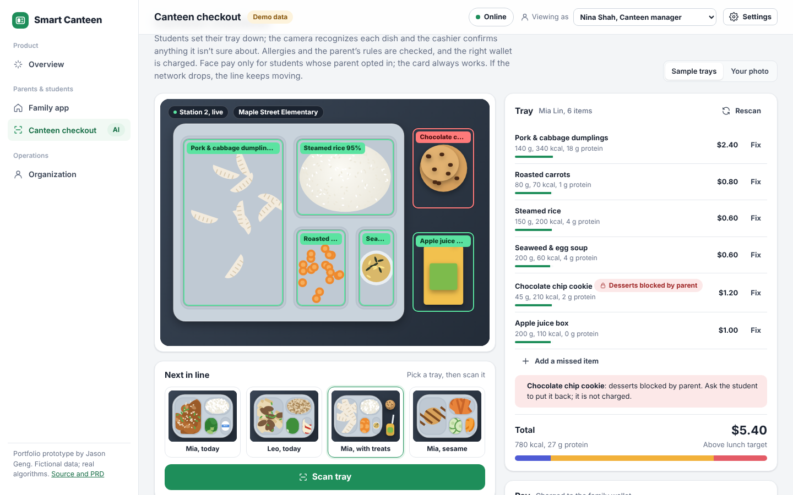
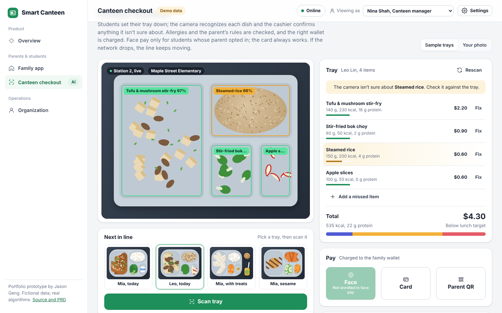
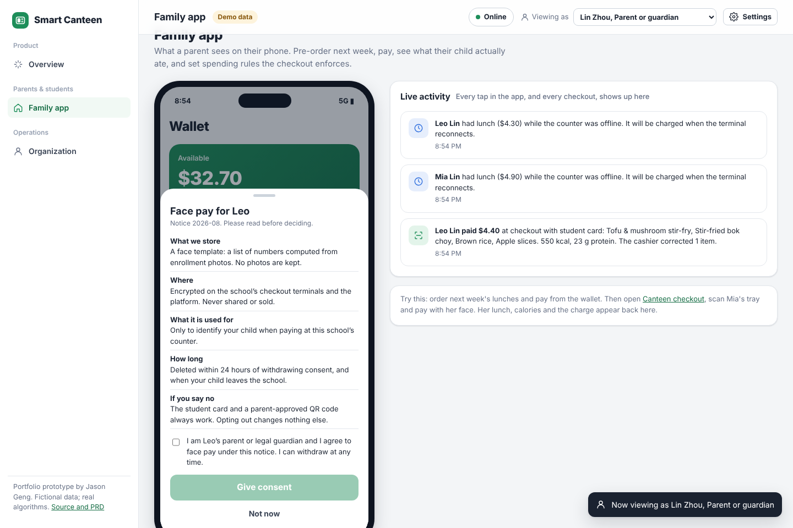
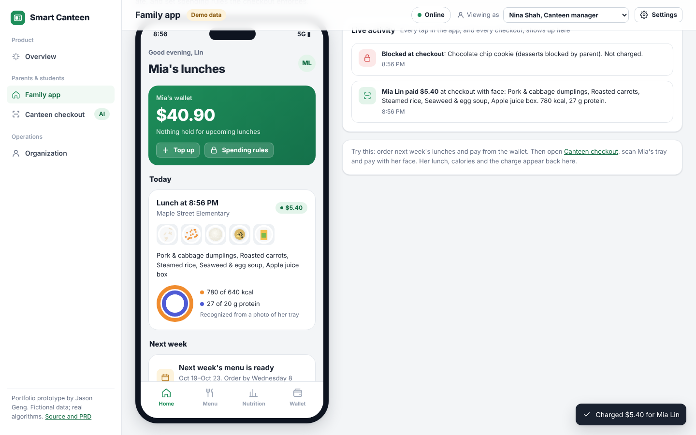
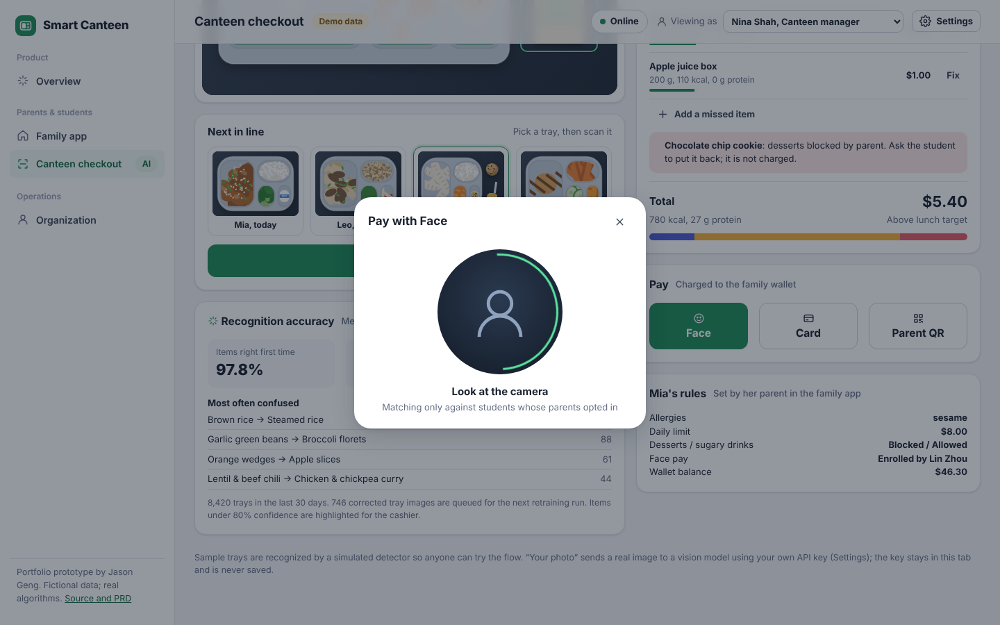

# Smart Canteen

**School lunch, end to end. A camera at the counter recognizes every dish on a tray, works out nutrition, enforces the parent's rules and charges the right wallet. Parents pre-order and see what their child actually ate; kitchens cook to real demand; regulators see food safety and every dollar.**

▶ **[Open the live prototype](https://jasonmayg.github.io/smart-canteen/)** — runs in the browser, no sign-up.
Suggested path: **Canteen checkout** → scan *Leo, today*, fix the rice the camera misread, pay by card (Leo isn’t enrolled in face pay) → click **Online** to go offline and keep selling → reconnect and watch sales settle → switch **Viewing as** to Lin Zhou (parent) and enroll Leo in face pay.

<p align="center">
  
</p>

## Why I built this

I led product for a school-catering platform used across hundreds of schools. This prototype rebuilds the product ideas from scratch, with fictional data, so they can be shown publicly. Requirements, metrics and risks are in the **[PRD](docs/PRD.md)**.

School lunch has five parties — parents, students, kitchens, schools and regulators — who don't share information. The core product decision: **make the money flow the backbone.** Once meal payments run through the platform, the food data (what was ordered, what was actually eaten), the safety data and the procurement trail come with them.

## What's in it

| Area | What you can do |
|---|---|
| **Canteen checkout** (AI) | Pick a sample tray and scan it: each dish is detected with a confidence score, priced, and summed into calories and macros. Anything containing the child’s allergens is stopped first, whatever else is allowed; desserts or sugary drinks the parent blocked are flagged and not charged; anything over the daily limit is declined. Pay with face, student card, or a parent-approved QR code. **Your photo mode** sends a real photo to a vision model with your own API key. |
| **Family app** | A parent's phone app: wallet with top-up, pre-ordering next week with standard / light / halal sets, away days refunded automatically, money held in bank escrow until each lunch is served, lunch notifications, a nutrition report with plain-language insights, allergies, and spending rules the checkout enforces. |
| **Cashier corrections** | Items the camera isn’t sure about (under 80% confidence) are highlighted. The cashier can swap a dish, remove one or add a missed item in two taps. Every fix is saved for retraining and counted, so recognition accuracy is **measured from real service**: right first time, wrong dish, missed items, most-confused pairs. |
| **Face pay, with consent** | Face pay is opt-in only, by a parent, per child, after a plain-language notice (what is stored, where, for how long, what happens if you say no). Withdrawing deletes the face template. The **student card always works**. Consent changes go to the audit log, and the district sees enrollment by school. |
| **Offline checkout** | If the network drops mid-lunch, the line keeps moving. Sales are saved on the terminal against balances cached at the start of service, within limits ($8 a sale, $15 a student). When the connection returns, sales **settle once, in order**; if a wallet falls short, auto top-up covers it or the amount is recorded as owed and the parent is told. A child is never sent away hungry. The app installs and opens with no network. |
| **Roles** | District food-safety officer → school principal → canteen (checkout, kitchen, finance) → parent → student. Each level grants access only below itself and inside its own scope. Switch **Viewing as** to see the product as each of them. |
| **Kitchen** | Confirmed orders become a pull list; a headcount forecast with event adjustments covers unconfirmed days; a menu planner searches dish combinations under a cost cap and allergen exclusions; the daily safety checklist feeds the district. |
| **District dashboard** | Kitchens ranked by inspection risk with the formula on screen, meal fees in escrow, bank-traceable purchases, per-kitchen status. |
| **Working capital** | A caterer's credit line sized from its school contract and repaid automatically from meal fees. |

Everything is connected: an order in the family app changes the kitchen's headcount; a checkout payment appears in the parent's activity, wallet and nutrition report; a ticked checklist moves the district's numbers.

<p align="center">
  
  
</p>
<p align="center">
  
  
</p>

## The AI, honestly

| Feature | How it works | Real or simulated |
|---|---|---|
| **Tray recognition, sample trays** | Trays are drawn procedurally; a simulated detector returns each compartment's dish, box and confidence | Simulated, so anyone can try the flow without a key |
| **Tray recognition, your photo** | The photo is downscaled and sent to a vision model (Claude) with a prompt that asks for JSON: dish, grams, calories, macros, confidence, bounding box. Results are matched to the canteen's dish library for price and allergens; unmatched items are labeled as model estimates | Real. Your key stays in the tab's memory and is never saved |
| **Headcount forecast** | Recency-weighted same-weekday average + trend + event adjustments; 80% range from back-tested error | Real code, simulated history |
| **Menu planner** | Searches every combination per day under a cost cap and allergen exclusions, scored on calorie and protein targets, with variety rules across the week | Real code, fictional dish library |
| **Inspection ranking** | Severity × repeats × days since last inspection | Real ranking over simulated detections |
| **Allergy guard** | Allergens on every library dish are checked against the child’s allergies before payment; items the model couldn’t match are flagged “allergens unknown” for staff | Real |
| **Recognition accuracy** | Computed from cashier corrections (swap, remove, add) over 30 days of trays plus this session; low-confidence items flagged for review; corrected images queued for retraining | Real code, simulated history |
| **Nutrition insights** | Rules over a week of recognized lunches (protein days, missed vegetables, treats, calorie range) | Real |

## Product decisions worth discussing

- **Recognition at checkout instead of manual logging.** Parents don't log school meals. Recognizing the tray at the moment of payment gives nutrition data as a by-product of something that has to happen anyway.
- **Rules enforced at the counter, not in a report.** A weekly report that says "Mia bought 3 cookies" is too late. The rule runs before payment, the item isn't charged, and the parent is told.
- **Escrow, not prepaid revenue.** Pre-ordered money sits with a custodian bank until the lunch is served, so away-day refunds are instant and the regulator can audit every dollar.
- **The cashier is part of the AI.** A model that is right 98% of the time is wrong on two items a tray-line, every few trays. Highlighting low-confidence items and making a fix two taps turns the cashier into the quality check, and every fix becomes training data and an accuracy metric.
- **Biometrics for children need consent you could defend in court.** Opt-in by a parent after a real notice, easy withdrawal that deletes the template, and a card that always works. A school that won’t enable face pay at all still gets the whole product.
- **Offline is a business requirement, not an edge case.** Selling against cached balances is a credit risk, so it’s capped per sale and per student, and settlement is idempotent and ordered so the books always match.
- **AI that degrades gracefully.** Without a key, the product still works end to end on sample data; with one, the same pipeline runs on real photos and labels anything it couldn't match.

## Tech

Static site and installable PWA (works offline; see **[OFFLINE](docs/OFFLINE.md)**): HTML, CSS and vanilla JavaScript modules, Canvas for the trays, inline SVG for charts. No build step, no backend. Demo state is saved in the browser (Settings → Reset demo to start over).

Product logic (menu planning, forecasting, risk, checkout rules, nutrition insights, access control, consent, offline settlement, recognition corrections) lives in DOM-free modules covered by unit tests (`npm test`, Node 22) that run in CI. See **[ARCHITECTURE](docs/ARCHITECTURE.md)**.

```
assets/js/
  lib/        format (pure), ui (DOM helpers)
  domain/     data, menu, forecast, risk, nutrition, rules, org, consent, pos, recog   (pure, tested)
  services/   vision: the optional live model call
  render/     tray: Canvas drawing for sample trays
  views/      overview, family, checkout, kitchen, district, finance, settings
  state.js    store, activity feed, seed data      main.js   shell and router
tests/        node:test suites for domain/
```

## Credits

Designed and built by **Jason Geng**. All schools, people, suppliers and figures are fictional.

---

© 2026 Jason Geng. All rights reserved. Shared for portfolio review.
