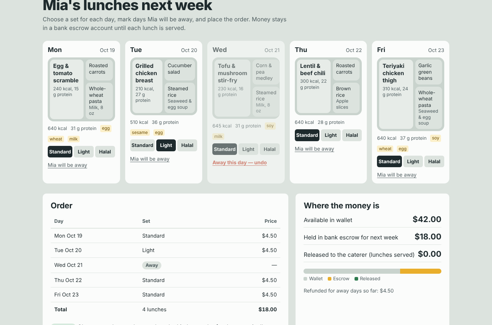
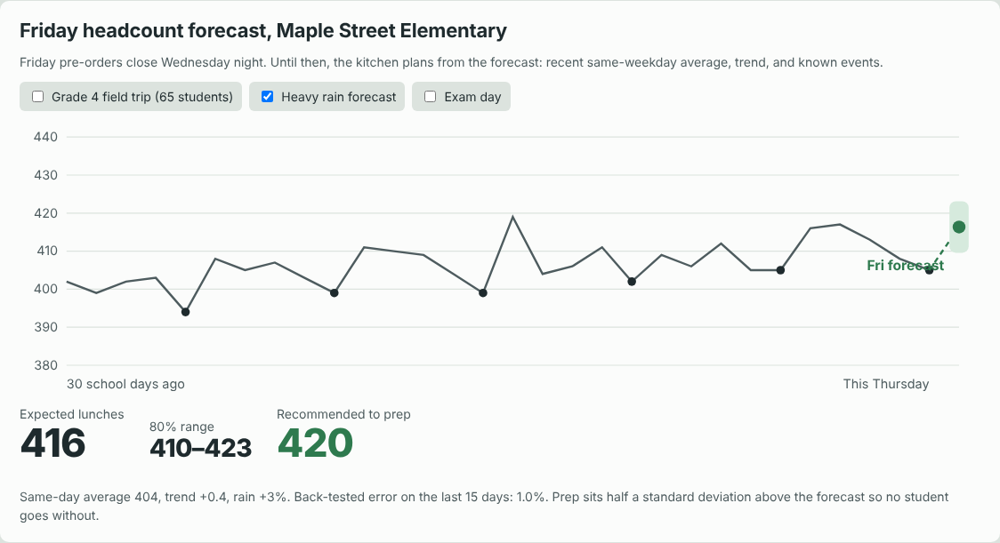
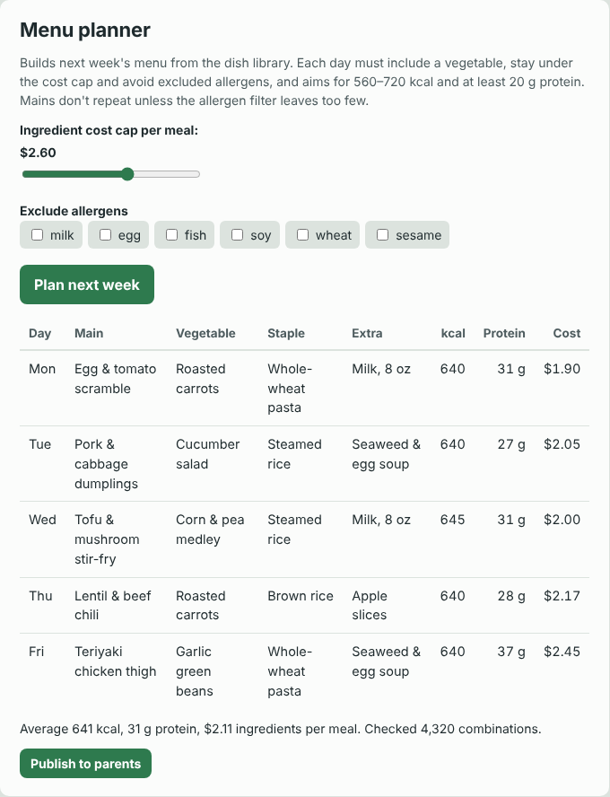
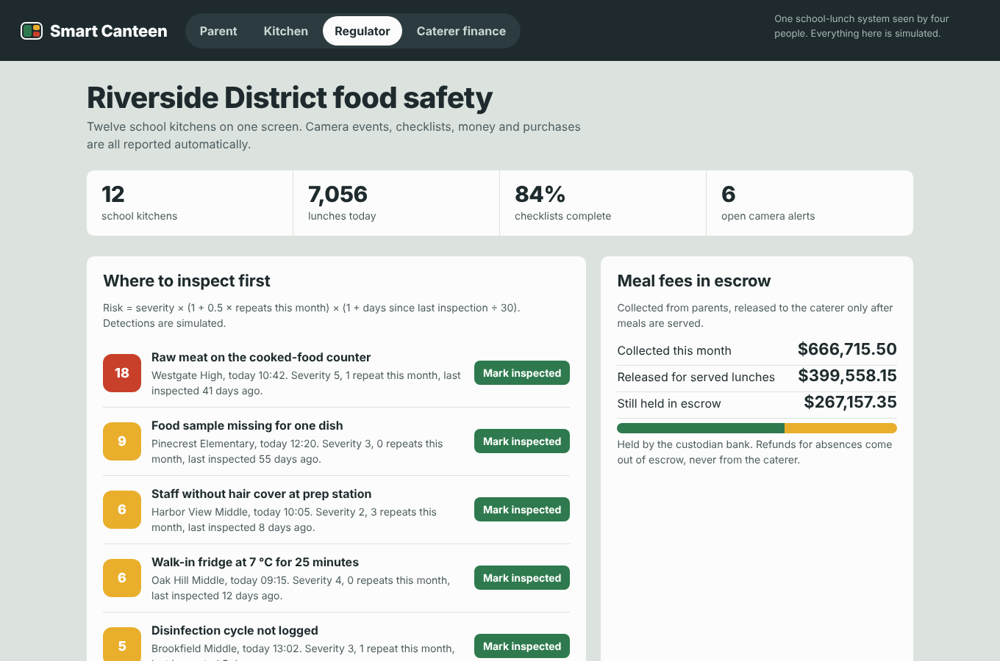

# Smart Canteen

**School lunch, end to end: parents pre-order, kitchens forecast and plan menus, regulators watch food safety and money — one system, four views.**

▶ **[Try the live demo](https://jasonmayg.github.io/smart-canteen/)** — runs in the browser, no sign-up. Start with the Parent view and follow one lunch through the system.

  

## Why I built this

I led product for a school-catering platform used across hundreds of schools. This demo rebuilds the core product ideas from scratch, with fictional data, so they can be shown publicly. The full product thinking is in the **[PRD](docs/PRD.md)**.

School lunch has five parties — parents, students, kitchens, schools and regulators — who don't share information. The key product decision: **make the money flow the backbone.** When meal fees run through the platform (parent → bank escrow → kitchen), food orders, safety records and procurement data come with them.

## What you can do in the demo

| View | Try this | What it shows |
|---|---|---|
| **Parent** | Pick sets for next week, place the order, then mark a day as away | Pre-ordering, automatic refunds, fees held in escrow until lunch is served, nutrition vs. targets |
| **Kitchen** | Check tomorrow's orders, toggle a field trip or rain on the forecast, run the menu planner with a lower cost cap | Orders become a production plan and an ingredient list; forecasting for unconfirmed days; constrained menu planning |
| **Regulator** | Mark the top alert as inspected | Risk-ranked inspection list, escrow totals, bank-traceable purchases, per-kitchen status |
| **Caterer finance** | Change the deposit or repayment share | Credit sized from a school contract; repayment split automatically from meal fees |

Views are connected: a parent's order shows up in the kitchen's counts, the kitchen's safety checklist feeds the regulator's dashboard, and a published menu changes what parents see.

  
  

## The algorithms (real code, simulated data)

| Feature | Decision it changes | How it works |
|---|---|---|
| **Headcount forecast** | How many lunches to cook before parents confirm | Recency-weighted same-weekday average + trend + event adjustments; 80% range from back-tested error; prep half a standard deviation above the forecast |
| **Menu planner** | Next week's menu | Searches every dish combination per day under the cost cap and allergen exclusions, scores distance to calorie and protein targets, and enforces variety across the week |
| **Inspection ranking** | Which kitchen an inspector visits first | Risk = severity × (1 + 0.5 × repeats) × (1 + days since last inspection ÷ 30), shown on screen so it can be challenged |
| **Credit sizing** | How much working capital a caterer gets | The smaller of 80% of 1.5 months' contract value and 5× the deposit; repayment simulated day by day |

Camera "detections" are simulated events; the ranking on top of them is real.

## What I'd measure in production

Pre-order adoption, food waste (cooked minus served), forecast error, checklist completion, time from alert to fix, caterer days-to-cash, and parent complaints per 1,000 meals. Targets and reasoning are in the [PRD](docs/PRD.md#6-success-metrics-what-i-would-measure-in-production).

  

## Tech

One HTML file: vanilla JavaScript, CSS and inline SVG charts. No build step, no dependencies, no backend. State is kept in the browser so the demo remembers your changes.

## Credits

Designed and built by **Jason Geng**. All schools, people, suppliers and figures are fictional.

---

© 2026 Jason Geng. All rights reserved. Shared for portfolio review.
